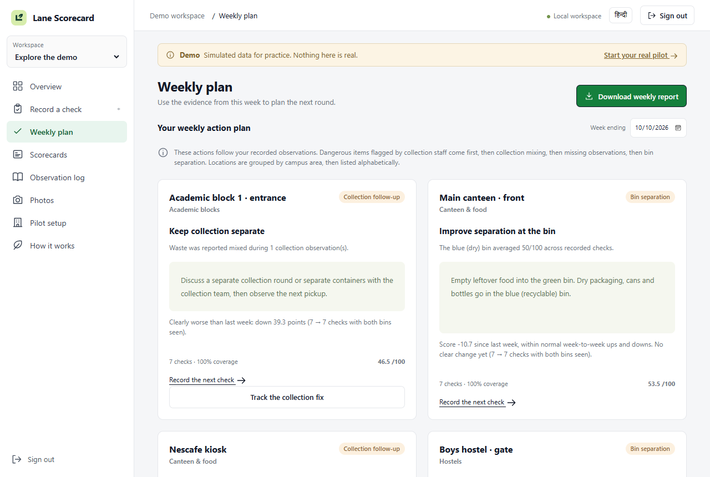
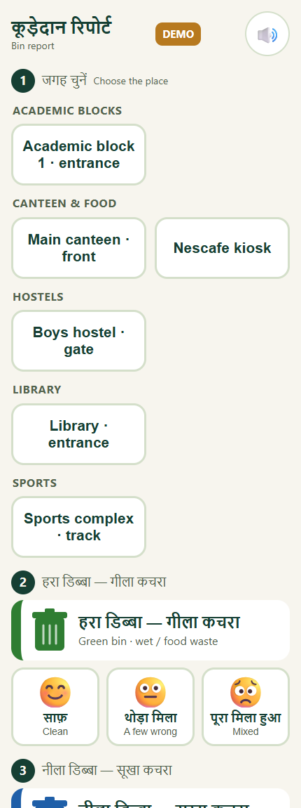
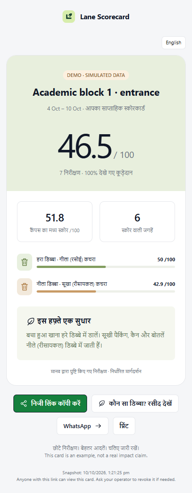
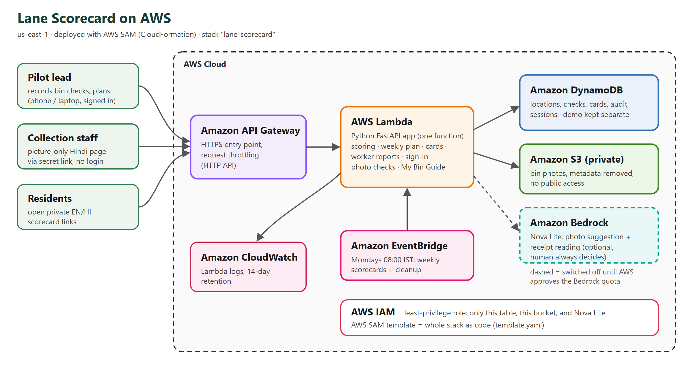

# Lane Scorecard

**Campus bins have two colours, but nobody checks whether people actually sort into them.** Lane Scorecard turns short bin checks into a score per location, one practical fix per week, and private English/Hindi feedback. It includes a picture-only Hindi page for the collection staff who sort mixed waste by hand.

**Live on AWS:** https://ss9ib2qbek.execute-api.us-east-1.amazonaws.com (open it: no sign-in needed to look around; see [Try it without signing in](#try-it-without-signing-in)) · **Demo video:** _link added at submission_ · **Track:** Waste and Energy

| Weekly plan (one fix per location) | Collection staff page (picture-only Hindi) | Private scorecard (Hindi) |
|---|---|---|
|  |  |  |

_Screenshots use the clearly labelled **Demo** workspace (simulated data). Real pilot data lives in a separate workspace._

## Try it without signing in

Open the [live site](https://ss9ib2qbek.execute-api.us-east-1.amazonaws.com). Anyone can look around in view-only mode: the overview, weekly plan, scorecards, observation log and photos, for both workspaces.

- **Your real pilot** (Workspace menu): the real NSUT checks from 9 Oct 2026 and their bin photos. Visitors open on the latest week that has checks.
- **Explore the demo**: simulated data, clearly labelled, with several weeks of history for the weekly plan and "vs last week" check.
- **[My Bin Guide](https://ss9ib2qbek.execute-api.us-east-1.amazonaws.com/guide)** ([Hindi](https://ss9ib2qbek.execute-api.us-east-1.amazonaws.com/guide?lang=hi)): paste a receipt or order list (Zepto, Blinkit, a shop bill) and see which bin each part goes in.

Recording, correcting or deleting checks, renaming locations and creating links all need the operator sign-in, so visitors cannot change the pilot data. The collection staff link and the audit log stay operator-only. `LANE_PUBLIC_VIEW=0` switches view-only access off; `tests/test_public_view.py` checks both modes.

## How it runs on AWS



| AWS service | The job it does here |
|---|---|
| **AWS Lambda** | Runs the whole app (Python FastAPI): scoring, weekly plan, scorecards, staff reports, sign-in, photo checks |
| **Amazon API Gateway** (HTTP API) | The public HTTPS address, with request throttling |
| **Amazon DynamoDB** | Stores locations, checks, scorecards, audit log and sessions; demo and real pilot kept apart |
| **Amazon S3** (private) | Bin photos, with image metadata removed and no public access |
| **Amazon EventBridge** | Every Monday at 08:00 IST: makes the weekly scorecards and cleans up old data |
| **Amazon CloudWatch** | Lambda logs (14-day retention) |
| **AWS IAM + AWS SAM** | Least-privilege role (only this table, this bucket, Nova Lite); the whole stack is code in `template.yaml` |
| **Amazon Bedrock** (Nova Lite) | Suggests a bin rating from a photo and reads receipt photos. A human always makes the final call. **Currently off:** our new account's Bedrock quota is 0, and an AWS quota case is open (10 Oct). |

## First real campus data (NSUT, 9 Oct 2026, evening)

| Measure | Result |
|---|---|
| Real checks recorded | 9 checks with 14 photos, at 9 bin locations (kiosk, canteen, paths, roadside bins) |
| Blue (dry) bin | **Clean in 7 of 7** checks where it could be seen |
| Green (wet) bin | **Never clean**: mixed in 5, a few wrong items in 2 (of 7 seen) |
| Most common problem | **Plastic in the green bin**: tagged in 6 of 9 checks |

**What this means:** the dry bin works; the wet bin fails because plastic goes in it. So the useful fix is narrow ("keep plastic out of the green bin"), not a generic "please segregate" poster. This is the kind of specific action the weekly plan produces.

**Limits, stated plainly:** this is one evening at one campus. Ratings were read from photos and are being confirmed by the team, and location names are being finalised. It is an early signal, not proof of impact. More checks are being added during the event.

## Problem statement and provenance

**Problem:** help campus staff identify where two-bin waste segregation breaks down, give residents useful feedback, and track changes without collecting resident identities. It fits Environmental Hacks' **Waste and Energy** track. This is our chosen problem statement within the event's open tracks. The build began before the event opened; theme fit does not establish entry eligibility. See [problem statement and requirement mapping](docs/PROBLEM_STATEMENT.md).

**New to the project? Read the [team guide](docs/TEAM_GUIDE.md) first.** It explains everything in plain words, with no AI tools needed. To test it, follow [docs/TESTING.md](docs/TESTING.md).

Start with the [complete project guide](docs/PROJECT_GUIDE.md), [AWS deployment guide](docs/AWS.md), or [project writeup](docs/PROJECT_WRITEUP.md).

**Status (11 Oct 2026):** deployed on AWS (stack `lane-scorecard`, us-east-1) at https://ss9ib2qbek.execute-api.us-east-1.amazonaws.com, using DynamoDB storage. The Hindi fixes (`92212c5`) were redeployed on 11 Oct at 14:39 IST. CloudFormation finished successfully, the Lambda code checksum matched the release, and the existing data resources were retained. Live checks passed for health, the deployed JavaScript and guide page, and Hindi receipt parsing (milk and banana recognised, zero unknown items). [Open in Hindi](https://ss9ib2qbek.execute-api.us-east-1.amazonaws.com/?lang=hi). AI is **off** (`EnableAI=0`). Every Bedrock on-demand and cross-region quota on the new account is 0, so calls fail with "Operation not allowed". Quota case 179161739400986 is open. Receipt photos and bin-photo suggestions need a redeploy with `EnableAI=1` once it is approved. The real pilot has 9 checks from 9 Oct (see above); their ratings are being confirmed.

## Open it

On this computer, open **http://127.0.0.1:8765** while the server is running. Paste the operator access code from `.local/admin-code.txt` into the sign-in screen.

To start it again, open PowerShell in this folder and run:

```powershell
.\start.ps1
```

`start.ps1` runs the app using its isolated Python environment. The terminal prints the address and access code. Keep that terminal running; Ctrl+C stops it. The address works on this computer only.

For a new computer, install Python 3.12, then run:

```powershell
.\setup.ps1
.\start.ps1
```

`setup.ps1` creates `.venv`, a project-specific dependency folder, then installs the packages listed in `requirements.txt`. It does not create AWS resources. If your PowerShell policy blocks scripts, run `.venv\Scripts\python.exe run.py` after setup, or run the commands inside the scripts individually.

## Try the whole flow

1. Sign in and explore **Demo**. Every demo check, including new ones entered there, is labelled simulated.
2. Choose **Your real pilot**. It starts empty.
3. In **Pilot setup**, add your location names and confirm permission.
4. In **Record a check**, choose the location, date and morning/evening round. Rate both bins and confirm you personally checked them. A photo is optional.
5. Open **Scorecards** and create a card. Open it, switch to Hindi, print it, or copy its private link.
6. Review or correct checks in **Observation log** and download a CSV. Corrections and deletions revoke existing cards in that workspace to avoid sharing stale results; regenerate the cards afterwards.
7. Open **Weekly plan** for one evidence-based action per location. Download the aggregate weekly report, then open it in a browser to print or save as PDF. Use **Record the next check** to follow up on a selected location.

Local links are only usable on the computer running the server. WhatsApp sharing opens a prefilled message; it does not send messages automatically. A remote recipient needs a deployed site to open its links.

## Implemented

- Responsive dashboard, mobile check form, observation log and pilot setup. On phones and smaller tablets, navigation opens as a drawer with a close button, outside-tap dismissal and automatic closing after page selection; opening it preserves unfinished check drafts.
- Separate demo and real-pilot records, with explicit source labels on screens, cards and exports.
- Persistent SQLite database locally; DynamoDB storage adapter for AWS.
- Two-bin scoring, observation coverage, community median, four-week trend and downstream collection observations.
- Weekly action plan based on collection mixing, missing observations and bin contamination, with English/Hindi action text.
- Standalone printable weekly report with aggregate scores and actions; private notes, photos and links excluded.
- Collection staff link: a secret, revocable URL (Pilot setup → Collection staff link) that opens a picture-only Hindi page at `/w/<link>`. Staff tap the location, a face for the green (wet) and blue (dry) bin, and an optional dangerous-item button; every tap is spoken in Hindi. Reports are saved as the location's **collection** check for today (a second tap the same day replaces it) and are rate-limited per link.
- Issue tags (plastic in the green bin, food in the blue bin, everything in one bag) on the pilot lead form and worker page. The scorecard turns the location's most frequent tag into four short parts: what went wrong, why it matters, how other locations did (only with 2+ other locations), and one thing to try. Fixed bilingual templates in `app/scoring.py` (`ISSUES`), no AI text.
- Optional sanitary and special-care ratings: the four streams named in the SWM Rules 2026 (Gazette S.O. 388(E), duties of waste generators: wet, dry, sanitary, special care). A two-bin site leaves them as "No such bin", and nothing changes for it. A rated extra bin counts in coverage, the location score and the weakest-bin tip. "Both bins clean" and the week-over-week outcome stay on the green + blue bins, so the compared statistic does not change.
- **My Bin Guide** (`/guide`, public, nothing stored): paste a receipt or order (Zepto, Blinkit, Zomato, a shop bill), or add a photo, and see which bin each *part* goes in (milk pouch → dry, peel → wet, pad → sanitary, battery → special care). Reviewed bilingual rules in `app/guide.py` decide. With `EnableAI=1`, Bedrock Nova Lite reads receipt photos and suggests bins only for items the rules don't cover, labelled "AI suggestion". With AI off, the page says the photo was not read. The receipt teaches the household; it is never shown to the collector or used for scoring.
- Random deep checks: each week about one location in five (at least one) is picked for a check below the top layer, using a keyed hash of the operator secret, so residents cannot predict it. The form, the staff page ("I looked below the top layer") and the new tag "wrong items hidden underneath" record it; the dashboard and report count deep checks and hidden items found.
- Community goal (**proposal**, not an existing scheme): the number of weeks in a row with both bins clean in at least 90% of checks (minimum 5 checks), out of 12. A community that holds the goal could apply for a shared benefit such as priority for a public EV charging point. No household gets points or money, because individual rewards can crowd out the habit. For reference, Delhi EV Policy 2.0 (in force 1 July 2026) bans new petrol two-wheeler registrations from 1 April 2028; it does not make every new car electric.
- Collection follow-ups: a "keep collection separate" recommendation in the Weekly plan can become a saved action (responsible role, fix date, review date, history). It can be marked reviewed only after collection was observed separate on three distinct dates after the fix, with no mixing recorded. Corrections can reopen the review. These are pilot thresholds, not research standards (`app/followups.py`).
- Photos page: every uploaded bin photo with its location, area, date, round and bin, and a Delete button (with confirmation) that removes a wrong photo from its check without changing the ratings.
- Worker safety first: dangerous items flagged by staff become the location's top action and a column in the weekly report.
- Week-over-week follow-up: each location is marked clearly better, clearly worse, or no clear change, comparing only checks where both bins were seen; a change is called clear only beyond 5 points and two standard errors. This is a pilot rule, not a statistical proof (see `docs/FOLLOWUP_EVIDENCE.md`, simulated).
- Duplicate-check prevention: one check per location/date/round (morning, evening or staff collection).
- Corrections and deletion, permission confirmation and required human confirmation.
- Random private scorecard links, English/Hindi feedback, print layout, clipboard and WhatsApp sharing.
- Hindi throughout the operator screens, weekly plans and printable reports. Language switches preserve check drafts, and shared scorecard/guide links retain the selected language. My Bin Guide accepts reviewed Hindi item names as well as English.
- Operator sign-in, HttpOnly sessions, write-request protection, security headers and private photos.
- JPEG/PNG/WebP uploads, size/resolution limits and removal of image metadata.
- Optional Bedrock Nova photo suggestion with explicit disabled/unavailable states. No prediction changes a rating automatically.
- Per-stream operator agreement on attached photos; separate CLI for independently labelled evaluation sets.
- AWS SAM template: API Gateway, Lambda, DynamoDB, private S3, Bedrock permission, weekly EventBridge trigger and log retention.
- Maintenance commands for expired sessions and abandoned photos.
- Automated backend/SDK-contract tests and a real browser workflow with desktop/mobile screenshots.

## What remains external

Real Bedrock calls (the account's Bedrock quota is 0 while AWS reviews it), real-bin photo evaluation of the AI, confirmed ratings for the first real checks, more pilot days, and the demo video link above (the video is recorded; the YouTube link is added once it is uploaded). The code is public on [GitHub](https://github.com/techi101/lane-scorecard). These external steps are not claimed complete.

The worker page's Hindi voice uses the phone browser's built-in speech. It waits for voices to load and explains when a Hindi voice is missing or playback fails; picture-based reporting still works. Automated browser checks cover delayed voices, speech errors and reporting without speech. Audible playback on each target phone and usability with real staff still need checking.

Stretch ideas from the earlier research (Telegram sending, Polly audio and Strands-generated/RAG feedback) are **not implemented**. Four-stream ratings are optional, not required. Receipt reading by Bedrock is coded and contract-tested with a stub, but it has not been tested against a real AWS account. This version intentionally uses reviewed, deterministic bilingual guidance for the two-bin campus pilot. It does not claim to be an autonomous agent or a legal waste-compliance certificate.

## Understand the score

| Rating | Points | Meaning |
|---|---:|---|
| Clean | 100 | No visibly misplaced items |
| A few wrong items | 50 | A little visible contamination |
| Mixed | 0 | Substantial visible mixing |
| Not seen | Excluded | Missing, empty, obscured or not safely assessable |

For each seven-day window:

1. Average the observed ratings for each bin type on a location.
2. Average that location's available bin-type averages. A location with no observed bins has no score.
3. The community score is the mean of scored locations; the comparison median is the middle scored-location value.

Missing observations never become clean scores. Coverage is observed bin ratings divided by the two ratings expected in each recorded check. It does **not** measure missed rounds that were never recorded. Both-bins-clean rate uses only checks where both bins were observed. Collection separation uses only rounds where collection was observed. Bin-level averages shown on the dashboard are observation-weighted; location/community scores give the bin types/locations equal weight.

The previous-week comparison covers the immediately preceding seven days. A trend is an early observation, not proof that scorecards caused an improvement.

## Tests

```powershell
.venv\Scripts\python.exe -m pip install -r requirements-dev.txt
.venv\Scripts\python.exe -m pytest -q
.venv\Scripts\python.exe tests/browser_check.py
.venv\Scripts\python.exe tests/browser_hindi.py
```

The browser test uses headless Microsoft Edge on Windows. On other platforms install Playwright Chromium first with `python -m playwright install chromium`. It starts its own server on port 8766 and writes only to an isolated `.local/browser-*` folder. Test observations never enter your pilot database. Screenshots in `artifacts/` are test/demo evidence, not actual pilot results.

Tests use fresh temporary data directories. `validate.ps1 -Browser` runs backend tests, JavaScript syntax, SAM infrastructure lint and the browser workflow, writing results to `artifacts/validation.json`. `tests/test_cloud_contracts.py` validates SDK request/response handling using stubs; it is not a real AWS deployment test.

## Files worth knowing

| Path | Purpose |
|---|---|
| `app/main.py` | API, sign-in, observations, photos, private cards |
| `app/scoring.py` | Scoring math and bilingual feedback |
| `app/storage.py` | SQLite and DynamoDB document stores |
| `app/vision.py` | Image validation and Bedrock suggestion |
| `app/guide.py` | My Bin Guide: receipt rules (four streams) and Bedrock receipt reading |
| `app/followups.py` | Collection follow-up actions and their review rule |
| `web/` | Frontend; no frontend build tool needed |
| `template.yaml` | AWS infrastructure definition |
| `docs/AWS.md` | Deployment and real-cloud verification steps |
| `docs/PILOT.md` | Data collection and evaluation protocol |
| `docs/DEMO_SCRIPT.md` | Three-minute demo outline |
| `docs/BUILD_RECORD.md` | Actual build provenance and limitations |
| `.local/` | Private database, access code, photos and test data; never publish |

## Maintenance and limits

```powershell
.venv\Scripts\python.exe manage.py cleanup
.venv\Scripts\python.exe manage.py weekly-cards
```

The first command deletes expired sessions and unattached photos older than 24 hours. Attached photos remain until their check/location is deleted. The second creates cards for real-pilot locations over the seven days ending yesterday. The AWS schedule runs Monday at 08:00 IST, covering the week ending Sunday, then runs cleanup.

This is a small-pilot application, capped at 50 locations. It reads each workspace's observations when calculating reports. It has one shared operator code, not separate member identities or production role-based access. Login throttling is per server instance; AWS API Gateway adds request throttling. Scale, granular authorisation, automated independent backups and compliance review would need further work before a broad public rollout.

To back up local data, stop the server and copy `.local/lane.sqlite3`, `.local/photos/` and `.local/admin-code.txt` to a private location. Treat scorecard links as bearer secrets. Revocation removes the app's access path; it cannot recall screenshots or previously downloaded copies.

## AI assistance and licences

AI coding tools used: OpenAI Codex (main implementation) and Claude Code (research, the collection staff page, the week-over-week check, AWS deployment, campus scale-up, Photos and rename features, and this README's diagram and screenshots). No archived prototype source was copied into this implementation. Dependencies retain their own licences; see `docs/ATTRIBUTION.md`. No image-generation service was used.
