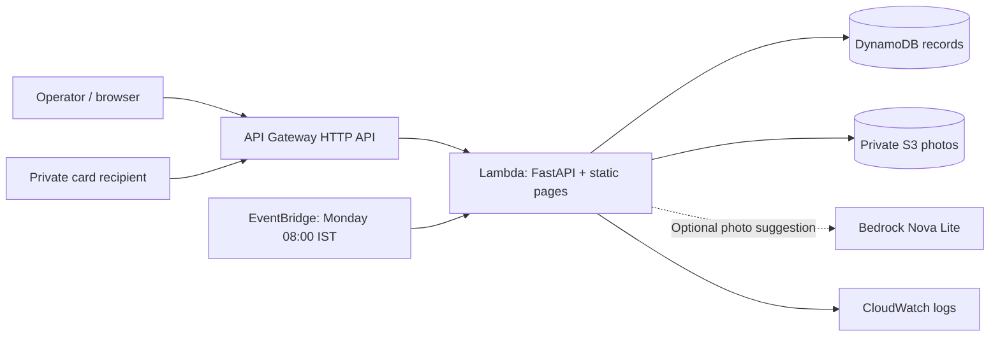

# Deploying later on AWS

Nothing in the local launch script deploys anything. This procedure is for a later, explicitly chosen deployment after account setup.

## Architecture



The same Lambda serves the pages and API to keep the deployment on one origin. This avoids the separate Amplify/CORS configuration from the earlier plan. DynamoDB and S3 hold persistent data; Lambda's `/tmp` is not used as the database.

## Prerequisites

- An activated AWS account and a non-root deployment identity with the required IAM/CloudFormation/S3/Lambda/API Gateway/DynamoDB/EventBridge/Logs permissions.
- AWS CLI, AWS SAM CLI, and Docker for a Linux-compatible build on Windows. The source contains Pillow's native dependency, so do not package Windows wheels for Lambda.
- Configure the AWS CLI using your chosen named profile. Never paste access keys into the app, frontend or repository.
- Use `us-east-1` for the supplied Nova cross-region inference profile, and verify account/model access before enabling AI.
- Choose a new random operator code at least 32 characters long. Store it privately.

## Stage, build and deploy

Check local setup without making AWS requests:

```powershell
.venv\Scripts\python.exe scripts/doctor.py
```

Install missing tools using the official [AWS CLI instructions](https://docs.aws.amazon.com/cli/latest/userguide/getting-started-install.html) and [SAM CLI installation guide](https://docs.aws.amazon.com/serverless-application-model/latest/developerguide/install-sam-cli.html). Configure your deployment identity locally; never send credentials in chat. Open a new terminal after installation so PATH is refreshed.

With a configured named profile, check deployment prerequisites and run the helper:

```powershell
.venv\Scripts\python.exe scripts/doctor.py --aws --profile lane
.\deploy.ps1 -Profile lane
```

The doctor checks the Linux Docker engine and STS authentication without creating cloud resources. Authentication does not establish CloudFormation/IAM permissions or Bedrock model access. `deploy.ps1` stages source, validates the template, builds Linux dependencies and invokes guided SAM deployment with changeset confirmation. To stop after the container build, use `deploy.ps1 -BuildOnly`.

SAM deployment behavior is documented in the [official command reference](https://docs.aws.amazon.com/serverless-application-model/latest/developerguide/sam-cli-command-reference-sam-deploy.html).

Run from the project directory:

```powershell
.venv\Scripts\python.exe scripts/prepare_aws.py
sam validate --lint
sam build --use-container
sam deploy --guided --region us-east-1
```

`prepare_aws.py` copies only application files into `artifacts/aws-src`. It excludes `.local`, access codes, photos, virtual environments, tests and docs. `sam validate` checks the infrastructure. `sam build --use-container` builds Linux-compatible dependencies. Only `sam deploy` creates or changes cloud resources.

Choose a stack name such as `lane-scorecard`. Enter the new code for the `OperatorCode` parameter. Keep `EnableAI=0` for the first deployment. Review the changeset before applying. The code parameter is `NoEcho`; if deployment tooling stores parameter values in `samconfig.toml`, keep that file private and do not commit it.

The stack outputs the `Website` URL. Open it, sign in, and test a complete demo observation. The real pilot remains empty until you add it.

## Run the Lambda locally (no AWS account)

This runs the same Lambda package in Docker with the AWS SAM CLI. It is a local AWS run, not a cloud deployment. Start Docker Desktop first.

```powershell
.venv\Scripts\python.exe -m pip install aws-sam-cli   # once
.venv\Scripts\python.exe scripts\prepare_aws.py       # copy current app/ and web/ into artifacts/aws-src
.venv\Scripts\sam.exe build --region us-east-1
'{"Web":{"LANE_TABLE":"","LANE_PHOTO_BUCKET":"","LANE_SECURE_COOKIE":"0"}}' | Set-Content local-env.json
.venv\Scripts\sam.exe local start-api --warm-containers EAGER --region us-east-1 --port 3011 --env-vars local-env.json --parameter-overrides "OperatorCode=<a new random code, 32+ characters>"
```

Open http://127.0.0.1:3011 and sign in with that code. Three things that break this if skipped:

- **Run `prepare_aws.py` before every build.** The template packages `artifacts/aws-src/`, not `app/`, so building without staging ships old code.
- **The function ID is `Web`.** The env file switches storage to the container's SQLite; without it the function calls real DynamoDB and fails with no credentials.
- **Use `--warm-containers EAGER`.** Otherwise each request gets a fresh container, its local storage is lost, and the sign-in session disappears on the next request.

Delete `local-env.json` afterwards; it is not needed for a real deployment.

## Turn on photo suggestions

1. Verify Nova Lite access with a permitted bin photo in your AWS account.
2. Update the stack parameter `EnableAI` to `1` after reviewing permissions and spending controls.
3. Upload a photo from the app. Confirm that it shows an actual AI suggestion and still requires your own rating.
4. Test an unavailable-model/error condition; the manual workflow must still work.

The default model is `us.amazon.nova-lite-v1:0`. Cross-region inference may process requests in more than one supported US region. Check your account's current model availability and data requirements. IAM is restricted to that inference profile and the Nova Lite foundation model. A different model needs corresponding code/configuration and IAM changes.

For locally running code against your own AWS account, set `LANE_ENABLE_AI=1` and configure the SDK's AWS profile/region. The local database stays SQLite unless `LANE_TABLE` is explicitly set. Uploading a photo with AI enabled then makes a real AWS request.

## Verify the real deployment

- Open the URL in a signed-out browser; operator data must require login.
- Record a demo check, refresh the page and verify persistence.
- Upload a permitted photo; confirm the S3 bucket is private and the operator can retrieve it.
- Generate a scorecard; open it without an operator session. Photos and private notes must not appear.
- Revoke the card; the link must stop returning card content.
- Test the scheduled Lambda with `{"source":"lane.schedule"}`. It creates real-pilot cards only for floors with observations in the preceding week. It does not send messages.
- Look for successful, real DynamoDB/S3/Bedrock requests in the account. Record results in the submission only after verifying them.

## Cost and cleanup

The stack can incur charges: HTTP API, Lambda, DynamoDB requests/storage/PITR, S3, logs and Bedrock. A budget alert sends a notification; **it is not a hard spending cap**. API throttling reduces traffic but does not guarantee a fixed bill. No claim of zero cost is made.

CloudWatch logs expire after 14 days. The database and photo bucket are **retained** on stack deletion to avoid silently destroying pilot data. Deleting the stack alone therefore does not remove all resources or costs. After exporting data and obtaining permission, remove retained resources separately when they are no longer needed.

## Environment variables

| Name | Default / meaning |
|---|---|
| `LANE_DATA_DIR` | `.local` locally; `/tmp/lane` in Lambda |
| `LANE_ADMIN_CODE` | Generated local secret; required cloud parameter |
| `LANE_TABLE` | Unset = SQLite; set = DynamoDB table name |
| `LANE_PHOTO_BUCKET` | Unset = local photos; set = private S3 bucket |
| `LANE_ENABLE_AI` | `0`; `1` permits real Bedrock calls |
| `LANE_MODEL_ID` | `us.amazon.nova-lite-v1:0` |
| `LANE_SECURE_COOKIE` | `1` in HTTPS deployment |
| `LANE_ORIGIN` | Optional explicit trusted origin; otherwise same-origin only |
| `LANE_PORT` | `8765` for local launch |

References: [AWS SAM HTTP API](https://docs.aws.amazon.com/serverless-application-model/latest/developerguide/sam-resource-httpapi.html), [Bedrock Converse](https://docs.aws.amazon.com/bedrock/latest/APIReference/API_runtime_Converse.html), [Mangum](https://mangum.fastapiexpert.com/).
