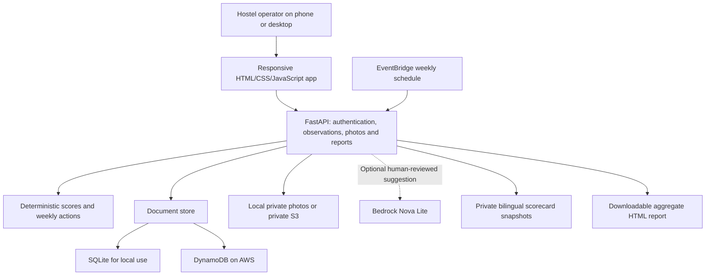

# Lane Scorecard project guide

## Run the finished local application

From the project folder in PowerShell:

```powershell
.\setup.ps1   # first installation only
.\start.ps1
```

Open http://127.0.0.1:8765. Sign in with the operator code shown in the startup terminal, also saved privately in `.local/admin-code.txt`. Keep the server running. The URL is local to this computer.

On macOS/Linux, create a Python 3.12 environment with `python3 -m venv .venv`, activate it, install `requirements.txt`, then run `python run.py`.

## Try a complete example

Use **Explore the demo** to inspect simulated records, trends, floor scorecards and the weekly plan. In **Weekly plan**, download the aggregate report, open it in a browser and print or save as PDF.

For real work, switch to **Your real pilot**, add a permitted floor, and record a morning or evening check. A floor/date/round combination can be recorded once; use the log to correct it. Photos are optional. The next-step button on each weekly-plan card selects that floor in the check form.

Private scorecard links show a snapshot. Corrections or deletions revoke the workspace's snapshots; regenerate and redistribute them. Downloaded reports are independent copies, so corrections cannot recall those files.

## Architecture



The AWS template puts FastAPI behind API Gateway and Lambda; both UI and API share one origin. The persistent data lives in DynamoDB and S3. Logs expire after 14 days. See [AWS.md](AWS.md) for cloud deployment and retained-data cleanup.

## How weekly actions work

Actions use only observations within the selected seven-day window, independently for each floor:

1. With no checks, ask for the first observation.
2. If collection was reported mixed, ask the operator to discuss separation with the collection team and observe the next pickup.
3. If bins were not seen, ask for fuller observations.
4. With complete observations showing contamination, suggest a practical action for the weaker bin type.
5. With fully clean observations, maintain the checking routine.

These are deterministic suggestions, with English/Hindi action text. They do not require an AI account. The floor list is alphabetical; it is not a resident leaderboard.

## Verify and package

```powershell
.venv\Scripts\python.exe -m pip install -r requirements-dev.txt
.\validate.ps1 -Browser
.venv\Scripts\python.exe scripts/doctor.py
.venv\Scripts\python.exe scripts/prepare_aws.py
.venv\Scripts\python.exe scripts/package_source.py
```

Full validation needs Node.js, cfn-lint and a Playwright browser. The browser check uses Edge on Windows. On other systems install Chromium with `python -m playwright install chromium`.

`artifacts/validation.json` records executed checks. Screenshots show generated demo or isolated test data. The source ZIP excludes access codes, `.local`, photos and virtual environments. The deployment stage includes only runtime source and `requirements.txt`.

## Project boundaries

This is a single-community pilot application with one shared operator code. It is not a multi-tenant municipal service. In-memory login attempt limiting is per Lambda instance, not a distributed account-wide limiter. The storage adapter reads whole entity partitions; for a much larger deployment, add user roles, indexed date queries, pagination and distributed throttling.

AWS account setup, live cloud deployment, real model evaluation, pilot permission and real observation collection require external access or human participation. They are not established by a passing local test suite.
